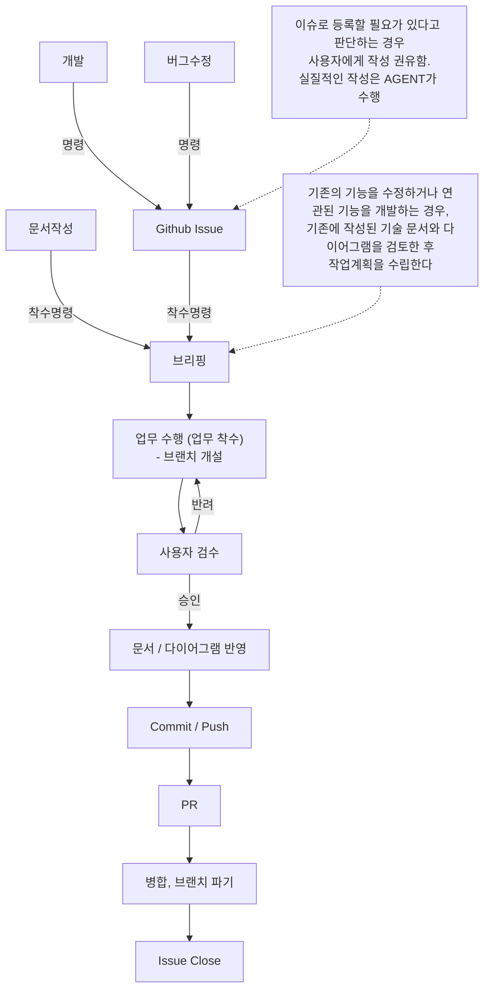

# Workflow 규칙

> AGENT 가 업무 수행시 지켜야하는 업무 프로세스
> 
> 해당 문서에 기재되어 있지 않은 업무가 발생한 경우, 이 지침에 대한 개선을 사용자에게 권유한다.

---

## 공통 최초 응답 규칙

사용자가 작업을 요청하면 바로 실행하지 않고, 다음 순서로 응답한다.

1. 현재 단계 표시
   - `[명령 / 착수명령]`처럼 워크플로우상의 현재 단계를 표시한다.

2. 요청 해석과 분류
   - 요청한 목적과 작업 내용을 짧게 정리한다.
   - 개발, 버그수정, 문서작성, 조사, 검토, 설정 등으로 분류한다.
   - 복합 요청이면 함께 표시한다.

3. 적용 절차 안내
   - 관련 규칙과 스킬을 확인하고 다음 단계를 설명한다.
   - 해당 작업에 없는 절차를 임의로 추가하지 않는다.

4. 확인된 사실과 미확정 사항 구분
   - 기존 대화·문서·코드에서 확인할 수 있는 내용은 먼저 확인한다.
   - 이미 제공된 정보는 다시 질문하지 않는다.
   - 코드만 읽고 내린 동작 판단은 ‘미검증’으로 표시한다.

5. 필요한 질문 제시
   - 목적, 작업 범위, 동작 방식, 완료 조건 중 빠진 내용을 질문한다.
   - 결과에 영향을 주는 사항을 임의로 확정하지 않는다.
   - 질문은 번호 목록으로 묶고, 가능하면 선택지를 제시한다.
   - 질문할 사항이 없으면 불필요한 질문을 만들지 않는다.

6. 작업 대상과 영향 안내
   - 예상 생성·수정·삭제 파일 또는 외부 작업 대상을 설명한다.
   - 조사 전이라 확정할 수 없는 내용은 예상임을 표시한다.
   - 브랜치 안내는 Git 관련 작업에만 적용한다.

7. 다음 행동 안내
   - 사용자 답변이나 승인 이후 무엇을 진행할지 설명한다.
   - 승인이 필요한 작업은 승인 전 실행하지 않는다.
   - 기존에 승인된 범위의 후속 작업은 승인을 반복 요청하지 않는다.

단순 질문·개념 설명·진행 상황 확인에는 위 형식을 강제하지 않고
질문에 직접 답한다.

## 전체 흐름



- 각 단계는 순서대로 진행하며, 이전 단계가 끝나지 않으면 다음 단계로 넘어가지 않는다.
- 단계를 건너뛰어야 할 경우, 이유를 사용자에게 보고하고 승인을 받는다.
- 현재 진행 중인 단계를 사용자가 알 수 있도록, 단계가 바뀔 때 `[단계명]` 으로 알린다.

### AGENT와 사용자의 역할

| 단계 | AGENT | 사용자 |
|---|---|---|
| 명령 / 착수명령 | 요청 내용 확인 | 작업 지시 |
| Github Issue | Issue 작성 권유 · 작성 | 내용 제공 · 승인 |
| 브리핑 | 작업 계획 수립 · 보고 | 승인 · 수정 요청 |
| 업무 수행 | 브랜치 확인 · 구현 | 브랜치 개설 |
| 사용자 검수 | 결과 · 검증 내역 보고 | 승인 · 반려 |
| 문서 / 다이어그램 반영 | 관련 문서 갱신 | 갱신 승인 |
| Commit / Push | 메시지 작성 안내 | 직접 수행 |
| PR | PR 작성 | 내용 확인 · 승인 |
| 병합, 브랜치 파기 | 결과 확인 | 직접 수행 |
| Issue Close | Close 여부 확인 | 최종 확인 |

**판단 기준** : Git 작업(브랜치, Commit, Push, Merge 등)은 AGENT가 직접 수행하지 않는다. 단, Github Issue와 PR 작성은 AGENT가 수행한다.

---

## 1. 명령 / 착수명령

> 업무의 종류를 먼저 구분한다.

- 사용자의 요청을 아래 세 종류 중 하나로 구분한다.
    - 개발 : 새로운 기능 추가, 기존 기능 개선
    - 버그수정 : 오류, 예상과 다른 동작의 수정
    - 문서작성 : 규칙 문서, 명세, 템플릿 등 문서 작업
- 개발 · 버그수정은 `2. Github Issue` 단계로, 문서작성은 `3. 브리핑` 단계로 진행한다.
- 종류가 모호하면 임의로 정하지 않고 사용자에게 질문한다.
- 작업지시서(`Docs/Temp/작업지시서.md` 등)로 지시를 받은 경우, 지시서의 내용을 우선으로 따른다.

## 2. Github Issue

> 이슈로 등록할 필요가 있다고 판단하는 경우, 사용자에게 작성을 권유한다.<br>
> 실질적인 작성은 AGENT가 수행한다.

- 독립적인 기능이나 완료 조건이 없는 짧은 수정으로, 영향 파일과 검증을 다음 작업의 브리핑·PR에 명확히 적을 수 있다면 작은 단위 작업으로 분류한다. 작은 작업만을 위한 별도 PR은 만들지 않고, 다음 작업과 직접 관련이 없어도 함께 수행해 해당 PR에 기록한다. 다음 작업이 아직 없으면 `.agents/state/deferred-small-tasks.json`에 요청 내용과 대상을 남긴다.
- 다음 작업을 브리핑할 때 보류한 작은 작업을 확인해 수정 파일·검증 항목에 포함한다. 해당 PR에 반영된 뒤 보류 기록에서 제거한다.
- 다음 작업 없이 작은 작업을 단독으로 마무리해야 하는 예외 상황이면 PR 작성 여부와 기록 방법을 사용자에게 별도로 질문하고 답변에 따른다.
- 진행 중인 작업이나 PR에서 작은 단위의 추가 수정이 필요하면 이유·대상 파일·검증 방법을 사용자에게 보고하고 승인받은 뒤 같은 작업과 PR에 포함한다. 승인 전에는 파일을 수정하지 않는다.
- 사용자가 Issue를 만들지 않기로 결정하면 해당 단계의 확인을 마친 것으로 보고 `3. 브리핑`으로 진행한다. 목적·요구사항·완료 조건은 작업 지시서 또는 승인된 브리핑에 기록한다. 전체 흐름의 Issue 등록과 Issue Close는 연결된 Issue가 있을 때만 적용한다.
- Issue 작성 · 등록은 `/github-issue` 스킬로 수행하며, 권유 조건과 작성 절차는 [Github Issue 작성 규칙](<../Documentation/Github Issue Rule.md>)을 따른다.
- 등록 후 Issue 번호를 보고하고, 사용자의 **착수명령**을 기다린다.

## 3. 브리핑

> 바로 작업하지 않고, 작업 계획을 먼저 보고한 뒤 승인을 받는다.

- 브리핑 양식은 [Codex 행동 규칙](<CodexCodeRules.md>)의 `기능 구현 착수 규칙`을 따른다.
- 작업 순서는 같은 문서의 `4. 검증 가능한 목표 (Goal-Driven Execution)` 포맷으로 작성한다.
- 관련 Issue가 있으면 브리핑에 Issue 번호를 함께 적는다.

### 기존 기능 수정 · 연관 기능 개발

> 기존의 기능을 수정하거나 연관된 기능을 개발하는 경우, 기존에 작성된 기술 문서와 다이어그램을 검토한 후 작업 계획을 수립한다.

- 검토한 문서와 다이어그램의 경로를 브리핑에 적는다.
- 문서와 실제 코드가 다르면 차이를 보고하고, 어느 쪽을 기준으로 할지 사용자에게 질문한다.
- 관련 문서가 없으면 "관련 문서 없음"으로 적는다.

### 승인 범위

- 승인 범위와 추가 승인 대상은 [승인 범위 컨벤션](<../Conventions/Safety/Approval Convention.md>)을 따른다.
- 답변이 없거나 시간이 지난 것을 승인으로 간주하지 않는다.

## 4. 업무 수행 (업무 착수)

> 승인된 범위 안에서만 작업한다.

### 브랜치 개설

- 작업 전 현재 브랜치를 확인한다.
- `main` 또는 `main-dev` 브랜치이면 작업을 거부하고, 사용자에게 브랜치 개설을 요청한다.
- 작업 브랜치는 `main-dev` 에서 만든다.
- 브랜치는 사용자가 직접 개설하며, AGENT는 [Git 컨벤션](<../Conventions/GitHub/Git Convention.md>)의 브랜치 이름 형식만 안내한다.
- 브랜치가 바뀐 것을 확인한 뒤 작업을 시작한다.

### 작업 진행

- 승인된 파일과 기능만 작업한다. 작업 범위 규칙은 [Codex 행동 규칙](<CodexCodeRules.md>)을 따른다.
- 소스코드 작성시 `Docs/Conventions/Code` 폴더의 컨벤션 문서를 확인한다.
- 작업 중 승인 범위 밖의 변경이 필요해지면, 작업을 멈추고 이유 · 대상 파일 · 영향을 보고한 뒤 승인을 기다린다.
- 검증은 [테스트 · 검증 컨벤션](<../Conventions/Safety/Testing Convention.md>)을 따른다.

## 5. 사용자 검수

> 결과를 보고하고, 사용자의 승인 또는 반려를 기다린다.

### 보고 내용

```
## 작업 결과 : [작업명]

**변경 파일**
- 파일 경로(변경 내용)
- ...

**검증 내역**
- 수행 : (실제로 확인한 항목과 결과)
- 미수행 : (확인하지 못한 항목과 이유)

**남은 문제**
- (없으면 "없음")

검수 부탁드립니다.
```

- 실제로 확인한 내용과 코드만 읽고 판단한 내용을 구분해서 적는다. 코드만 읽은 판단은 "미검증"으로 표기한다.
- Unity 에디터 실행 확인처럼 사용자가 직접 해야 하는 검증은, 확인 방법을 안내한다.

### 승인

- 사용자가 명시적으로 승인하면 `6. 문서 / 다이어그램 반영` 단계로 진행한다.

### 반려

- 반려되면 `4. 업무 수행` 단계로 돌아간다.
- 반려 사유가 분명하지 않으면 사유를 질문한다. 추측으로 수정하지 않는다.
- 반려 사유가 작업 범위를 바꾸는 경우, `3. 브리핑` 단계로 돌아가 다시 승인을 받는다.

## 6. 문서 / 다이어그램 반영

> 변경된 내용을 관련 문서와 다이어그램에 반영한다.

- 갱신 대상과 시점은 [문서 유지 컨벤션](<../Conventions/Work/Documentation Convention.md>)을 따른다.
- 갱신할 문서 목록을 먼저 보고하고, 승인 후 반영한다.
- 기술 문서는 `/tech-doc`, 다이어그램은 `/diagram` 스킬로 반영한다.
- 갱신할 문서가 없으면 "문서 반영 없음"으로 보고하고 다음 단계로 진행한다.

## 7. Commit / Push

> Commit과 Push는 사용자가 직접 수행한다.

- AGENT는 Commit · Push를 직접 수행하지 않는다.
- `main`, `main-dev` 브랜치에 Commit · Push하려는 경우 중단을 요청한다.
- Commit 시점 권유와 메시지 안내는 `/github-commit` 스킬로 수행하며, 작성 절차는 [Github Commit 작성 규칙](<../Documentation/Github Commit Rule.md>)을 따른다.

## 8. PR

> PR은 AGENT가 작성하며, 등록 전 사용자의 승인을 받는다.

- PR 작성 · 등록은 `/github-pr` 스킬로 수행하며, 작성 절차는 [Pull Request 작성 규칙](<../Documentation/Github PR Rule.md>)을 따른다.
- PR 대상 브랜치는 `main-dev` 이다. 대상 브랜치와 Issue 연결(`Closes #번호`)은 [Git 컨벤션](<../Conventions/GitHub/Git Convention.md>)을 따른다.

## 9. 병합, 브랜치 파기

> 병합과 브랜치 삭제는 사용자가 직접 수행한다.

- AGENT는 Merge · 브랜치 삭제를 직접 수행하지 않는다.
- 병합 방식은 [Git 컨벤션](<../Conventions/GitHub/Git Convention.md>)을 따른다.
- 병합 후 외부 도구 갱신은 [업무 흐름 컨벤션](<../Conventions/GitHub/Workflow Convention.md>)을 따른다.

## 10. Issue Close

> 연결된 Issue가 닫혔는지 확인하고 업무를 마친다.

- PR 병합 후 연결된 Issue가 닫혔는지 확인한다.
- 닫히지 않았으면 사용자에게 알리고, 승인 후 Issue를 Close 한다.
- 완료 기준은 [완료 조건 컨벤션](<../Conventions/GitHub/Completion Convention.md>)을 따른다.
- 모든 단계가 끝나면 진행한 작업을 한 줄로 요약해 보고한다.

