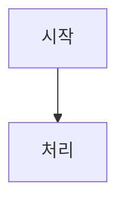

# 기술 문서 작성 템플릿

> 구현한 기술의 원리와 구현 과정을 정리하는 문서 작성에 필요한 템플릿이다.

## 사용 기준
> 작성 위치 · 작성 절차 · 보안 · 다이어그램 규칙은 [기술 문서 컨벤션](<../Conventions/Work/Technical Document Convention.md>)을 따른다.  
> 아래 `---` 아래부터 복사해 사용한다.

---

# <기술 이름>

## 1. 개요

> 사용자가 기대한 동작과 기능의 활용 목적을 확인해 2~3문장으로 적는다.

## 2. 구성 요소

> 직접 작성한 스크립트를 `이름 : 역할` 한 줄씩 적는다.

- 이름 : 역할

## 3. 동작 원리

> 사용자가 설명한 의도와 확인된 구현을 바탕으로 기능의 동작 흐름을 다이어그램으로 보여주고, 핵심 단계를 짧게 설명한다.

## 4. 구현 과정

> 어떤 기능·에셋·플러그인·엔진 기능을 어떻게 활용해 원하는 동작을 만들었는지 순서대로 적는다. 주요 선택의 이유는 사용자에게 확인해 반영한다.

- 활용한 기능 : 
- 구현 과정 : 

### 참고 레퍼런스

> 참고한 문서 · 영상 · 예제가 있으면 제목과 링크, 참고한 내용을 적는다. 없으면 이 섹션을 생략한다.

- [제목](링크) : 참고한 내용

## 5. 기존 방식과 비교

> 기존 방식을 바꾼 경우 아래를 적는다.

- 기존 방식 : 
- 달라진 점 : 
- 개선된 점 : 

> 신규 기능이면 위 항목 대신 이 기능이 필요하게 된 과정을 적는다.

- 필요하게 된 과정 : 
